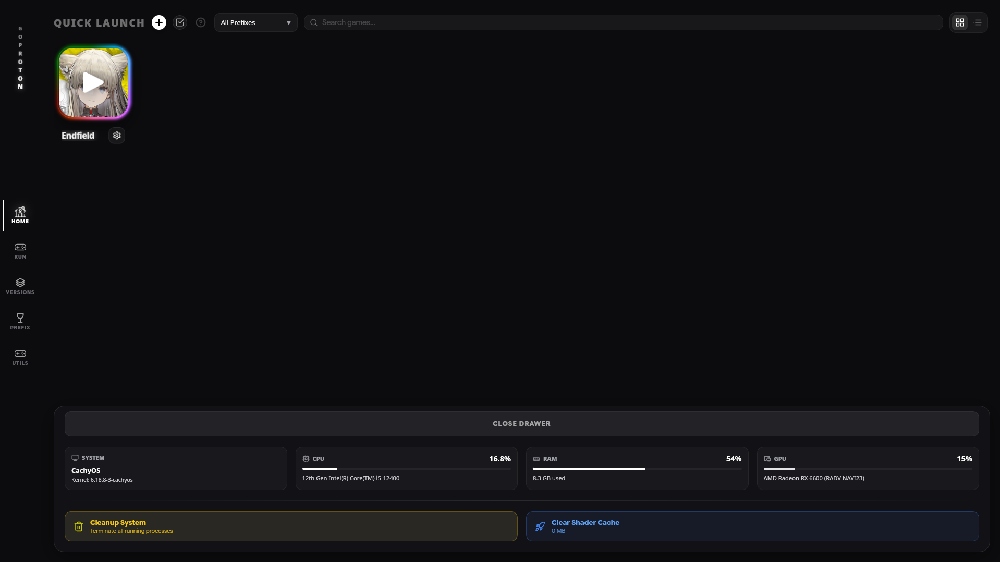
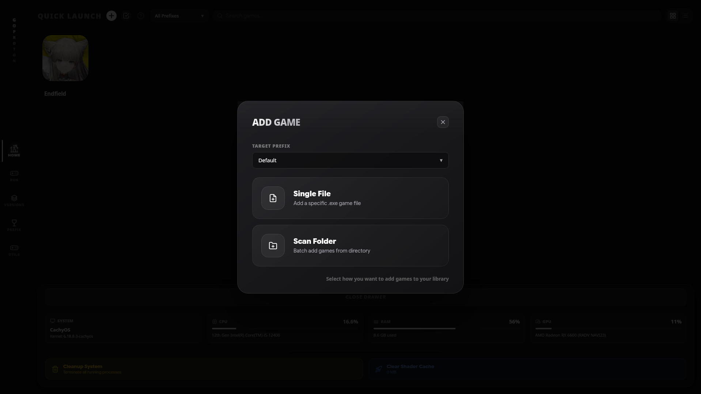
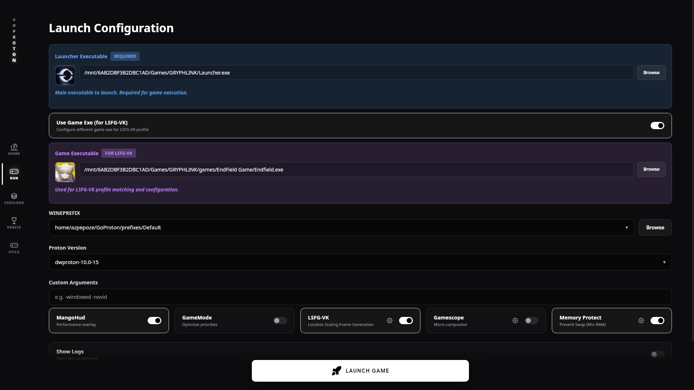
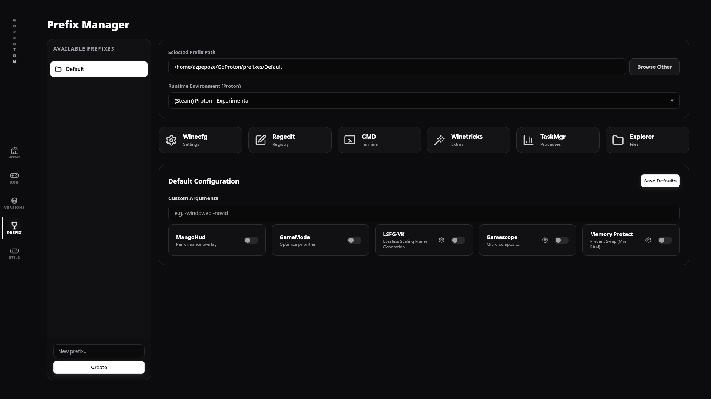
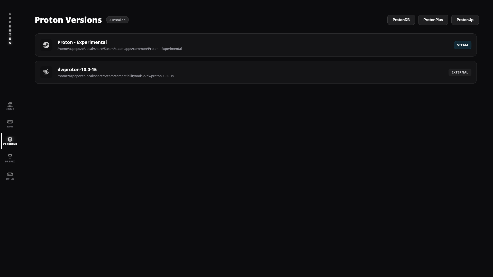
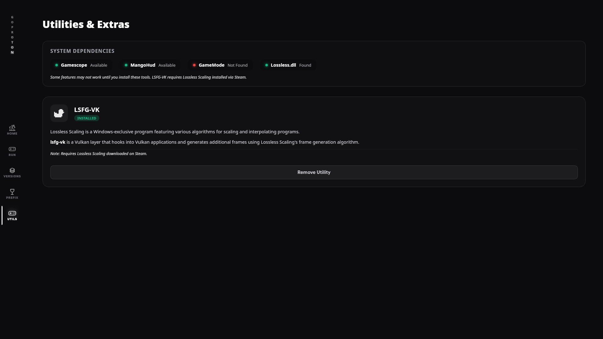

# LightLauncher

A game launcher for Windows and Linux. It keeps your games in one library and starts them.

LightLauncher is a Go program with a web-based window. On Linux it starts Windows games with Proton, using umu-launcher (`umu-run`). Proton is a compatibility layer from Valve that runs Windows games on Linux. On Windows it starts the game file directly. Plugins can add sources, such as F95 Zone or itch.io.

> [!WARNING]
> LightLauncher is in early development. Some parts are not wired yet. See [Known gaps](docs/usage.md#known-gaps).

## Screenshots

|               Home                |               Add games               |
| :-------------------------------: | :-----------------------------------: |
|        |  |
|                Run                |                Prefix                 |
|          |        |
|              Version              |                 Utils                 |
|  |          |

## Quick start

### Linux

1. Install umu-launcher and WebKitGTK 6.0 (the web engine that draws the window). On Arch:

   ```sh
   sudo pacman -S umu-launcher webkitgtk-6.0
   ```

2. Install LightLauncher. See [Install](docs/install.md).
3. Start it.

   ```sh
   light-launcher
   ```

### Windows

1. Download `light-launcher-<version>-windows-x64-setup.exe` from the [release page](https://github.com/AzPepoze/light-launcher/releases).
2. Run it. If it asks to install WebView2 (Microsoft's web engine for the window), choose **Yes**.
3. Start LightLauncher from the Start Menu.

> [!NOTE]
> The Windows window has not been run on a real Windows PC yet. See [Windows](docs/windows.md).

## Features

| Feature                                                  | Windows | Linux only |
| :------------------------------------------------------- | :-----: | :--------: |
| Add a game and start its `.exe`                          |   Yes   |            |
| Browse the library and settings                          |   Yes   |            |
| Plugins that add sources                                 |   Yes   |            |
| Start a game with Proton and umu-run                     |         |    Yes     |
| Prefixes (a separate Wine folder for each game or setup) |         |    Yes     |
| Lossless Scaling (LSFG) frame generation                 |         |    Yes     |
| Gamescope scaling                                        |         |    Yes     |
| MangoHud overlay                                         |         |    Yes     |
| GameMode tuning                                          |         |    Yes     |
| Steam Proton versions                                    |         |    Yes     |

> [!TIP]
> Linux-only features are hidden on Windows.

## More

| Topic                                               | Page                                       |
| :-------------------------------------------------- | :----------------------------------------- |
| Install on Arch, other Linux, and Windows           | [Install](docs/install.md)                 |
| Flags, game runner, plugin commands, file locations | [Usage](docs/usage.md)                     |
| Linux setup and window options                      | [Linux](docs/linux.md)                     |
| Windows setup and uninstall                         | [Windows](docs/windows.md)                 |
| Plugins: install, update, trust, permissions        | [Plugins](docs/plugins.md)                 |
| Write a plugin                                      | [Writing plugins](docs/writing-plugins.md) |
| What is protected and what is not                   | [Security](docs/security.md)               |
| Move data from older versions                       | [Migration](docs/migration.md)             |
| How the parts fit together                          | [Architecture](docs/architecture.md)       |
| Build from source                                   | [Building](docs/building.md)               |
| Window programs (GTK and WebView2)                  | [Shells](shell/README.md)                  |
| Publish a release                                   | [Releasing](docs/releasing.md)             |
| See what is missing or planned                      | [Known gaps](docs/known-gaps.md)           |
| Development setup and rules                         | [Contributing](CONTRIBUTING.md)            |

## License

See [LICENSE](LICENSE).
